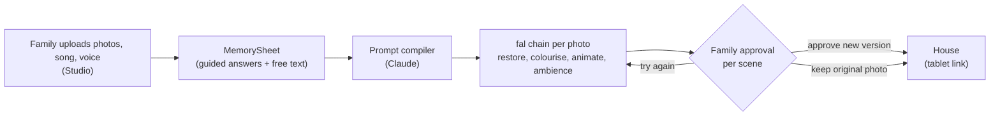

# memorAI

A family restores and gently animates its real old photos into short Memories, with the person's real song and the family's own voice, and shares them with a relative living with early-stage Alzheimer's through one link on a tablet.

Built at the Imperial AI Hackathon (14–15 Nov 2026), track Voice, Vision & Generative Media.

## The problem

When a parent lives with Alzheimer's, the family wants to share moments with them, but their memories sit in old photos that are often damaged or black and white. Turning those photos into something the person can enjoy takes editing skills and time that most families don't have. Generic AI video tools also make it easy to invent things that never happened, which is the last thing a family wants to show someone whose memory is fragile. The person watching needs something they can use without reading menus or recovering from errors.

## What we built

One Next.js app with two sides.

**Studio (`/studio`, the family side).** A family member with no technical skill:

1. Creates the House: the person's first name, a first Room (a standard garden, kitchen or living room, a photo of their real room, or a short description of a room), and a required consent checkbox.
2. Creates an Object (a Story): photographs a meaningful object, which becomes a 3D model, or picks one from a small 3D library.
3. Fills the Memory bank: photos, videos, the person's real song and a recorded family voice message.
4. Answers short guided questions (who, where, what it sounded like, which song, colour or black and white, OK to watch alone) plus optional free text.
5. Reads the Memory sheet, a plain-language summary of everything they said, and chooses movement type and length.
6. Presses "Bring to life" and watches each photo go through the generation steps.
7. Approves every scene: original vs new version, with "Keep the original photo" and "Try again" on each one.
8. Places the Object in the Room, orders the Memories, marks each one "OK alone" or not, and sends it to the House.
9. Hears back: views and Hearts sent from the House.

A Care & privacy screen holds a "Don't show" list of people or topics to keep out, and a delete-House action.

**House (`/house/[token]`, the side for the person living with Alzheimer's).** One private link, no login, nothing to read:

Choose a room → the Room appears with its Objects in fixed places → tap an Object → polaroids fly out → tap one, or the first Memory starts after 3 s → the Memory plays full screen with its song, ambience and family voice → a large Heart sends love back to the family → next Memory → gentle return to the Room. `?mode=alone` shows only Memories the family marked "OK alone"; the others fade in place.

## How it works



**Upload.** Photos are resized in the browser to 2048 px JPEG and saved to local disk (`storage/`), with a document per asset in MongoDB Atlas.

**MemorySheet.** The guided answers and optional free text are merged into one Zod-validated MemorySheet (`lib/contracts/`). Every creation method fills this same contract.

**Prompt compiler.** `lib/ai/prompt-compiler.ts` sends the MemorySheet to Claude and gets back structured JSON: a motion prompt, a negative prompt, an ambience prompt and a list of refused requests. The rules allow only subtle motion of what is already in the photo, never new people, objects, places or events, and ambience without music. If the free text asks to add something (for example a person who isn't in the photo), it goes into `refusedRequests` and the Studio says so gently. If Claude fails, fixed templates are used.

**fal chain.** Each photo becomes a job in MongoDB, advanced by a 5 s server ticker and by Studio polling: upload to the fal CDN → restore (Topaz) → colourise if the family chose it (Bria) → animate (Kling, 5 or 10 s) → ambience (MMAudio). Every output is downloaded to `storage/`. Failed steps retry twice, then fall back (a failed clip falls back to the still photo). A budget guard switches to mock mode above a set spend.

**Family approval.** No scene reaches the House until the family has made a choice for it: the new version, or the original photo.

**House.** The House requests one bundle (`GET /api/h/:token/bundle`) with published Stories only, preloads every file, then shows "Choose a room". Rooms and Objects render with react-three-fiber. In demo mode the House is served from an exported bundle and works offline.

## Principles

- **No false memories.** We animate only real photos, with subtle motion. We never add people, objects, places or events. Every model prompt goes through the prompt compiler.
- **Family approves everything.** Each scene needs an explicit choice (new version or original photo) before the Story can be sent.
- **Real voices only.** The family records its own voice. No voice cloning, no synthetic narration, no avatar. Generated sound is ambience only, never music; the song is the person's real song.
- **The House never looks broken.** No error text and no spinner after preload; a failed clip shows the original photo with its sound.

We make no medical claim. The idea is inspired by reminiscence and familiar music; the promise is a shared moment.

## Sponsor technology: how we used it

**What we enter.** Main track: **Voice, Vision & Generative Media**, going for the **Best use of fal** bounty. Extra prize: **Figma Best-Designed AI Product**.

**What we don't enter, and why.**
- **ElevenLabs and Anam** (track sponsors): not used, on purpose. Our rule is real voices only: no cloning, no synthetic narration, no avatar. An ElevenLabs voice agent that would *ask* the guided questions was planned as an option (`FEATURES.md` SH6) but not built.
- **Adaption:** that prize needs a fine-tuned model. We fine-tuned nothing, so we don't qualify.
- **MongoDB:** its bounty sits in the Autonomous Agents track, not ours. We use Atlas as our database (below) but don't enter it.

### fal: the generation engine (Best use of fal)

fal runs every generative step in the product: **11 endpoints for 9 different tasks**, chained per photo.

| Task | fal model | Where in the product |
|---|---|---|
| Repair scratches, fading, lost detail | `topaz/restore/image` | Every Memory photo, if the family keeps "Gently repair" |
| Bring colour back | `bria/fibo-edit/colorize` (fallback `fal-ai/ddcolor`) | Only when the family chooses colour |
| Gentle motion, 5 or 10 s | `fal-ai/kling-video/v2.5-turbo/pro/image-to-video` | Each photo the family wants to move |
| Sound of the place from the clip | `fal-ai/mmaudio-v2` | Ambience that matches what moves (no music) |
| Sound of the place for a still | `fal-ai/mmaudio-v2/text-to-audio` | Photos kept still |
| Cut the object out | `fal-ai/birefnet/v2` | Before 3D, so the background doesn't bleed in |
| Object photo → 3D model | `fal-ai/hyper3d/rodin/v2.5/fast` (fallback `fal-ai/trellis-2`) | The teapot, radio, etc. that the person taps in the House |
| Real room photo → Room background | `fal-ai/nano-banana-2/edit` | "Use a photo of their room" |
| Description → Room background | `fal-ai/nano-banana-2` | "Describe the room" |

How we call it: `@fal-ai/client` on the server only. Inputs go up with `fal.storage.upload` (1-hour expiry preference, we keep our own copies), then `fal.queue.submit` / `status` / `result` inside resumable MongoDB jobs: retries (2), a fallback per step, a cap of 2 concurrent requests, a cache keyed on input and params, and a budget guard that switches to mock above a set spend. Every output is downloaded to our storage. Swapping a model is a one-line change in `lib/ai/models.ts`.

Measured live (from `docs/STATUS.md`):
- One scene: Claude 6 s → restore 30 s ($0.08) → colourise 18 s ($0.04) → animate 94 s ($0.35) → ambience 9 s ($0.005). **157 s, about $0.48.** This was on a 480×360 test photo, not a real family photo.
- A 10 s custom-motion clip with 10 s of ambience, and a Room from a description in 13 s.
- Rodin vs Trellis 2 on 3 object photos: Rodin was cleaner on all 3 at $0.10 per model, so it is the default.

Limits, honestly:
- Kling can still change a face. Our only guard today is the family's approval of each scene; an automatic check is not built.
- Not run live end to end: a Memory with several photos, song and voice together. The fallback colouriser `fal-ai/ddcolor` has never been run live. (`fal-ai/nano-banana-2/edit` has: it made the standard garden and kitchen Room backgrounds from stock photos, and Rodin made the 3 library 3D Objects.)
- In mock mode the clip is always the same short placeholder.

### Figma: design source and two-way MCP workflow (Best-Designed AI Product)

- **Source of truth:** page "v5 · Full flow · memorAI", 17 frames at tablet size (1194 × 834), plus 8 frames added during the hackathon (voice recording, ordering, Story end, loading states, phone Studio and more). `docs/DESIGN.md` §2 maps every frame to its route and component.
- **Figma → code, through the Figma MCP server:** `get_metadata` listed every frame and node; `get_design_context` and read-only `use_figma` returned exact sizes, radii, shadows and opacities, so the 14 `components/ui` pieces were written from numbers; `download_assets` exported the logo, 3 Rooms and 9 Objects as SVG.
- **Code → Figma:** the 8 missing frames were built in the file with `use_figma` from the file's own components; one script pushed our 35 code tokens back into Figma as Variables and re-bound 16 Primary buttons to them, so design and code share names and values.
- **Evidence:** 14 v5 frames exported with `get_screenshot` next to code captures at the same size, in `docs/design-evidence/`; every difference is logged in `docs/DESIGN.md` §7.
- **Where code differs from Figma, on purpose or not yet:** we raised low-contrast text (0.45–0.65 opacity → 0.7) and the Primary button (3.2:1 → 4.9:1) to meet WCAG AA. Several Studio screens are simpler than their frames (for example no 4-step stepper, no polaroid grid in the Memory bank); `docs/DESIGN.md` §7 lists them.

### Anthropic Claude: the guardrail between family words and models

`claude-haiku-5-5` (via `@anthropic-ai/sdk`, structured output validated with Zod) turns the MemorySheet into the motion, negative and ambience prompts that fal needs. It enforces "only what is already in the photo": requests to add something go to `refusedRequests` and are shown gently to the family. It reads text only; it does not look at the photo or check the result. If Claude fails, fixed templates take over.

### MongoDB Atlas: data and job queue

Collections for houses, rooms, stories, memories, scenes, assets, events (views and Hearts), jobs and a generation cache (the same input with the same params reuses the stored output; "Try again" bypasses it). The jobs collection is the generation queue: each job holds a lease so two server ticks never advance the same step. We don't use Vector Search.

## APIs, models and datasets

All model IDs live in `lib/ai/models.ts`.

| Provider | Model ID | What we use it for |
|---|---|---|
| fal.ai (Topaz) | `topaz/restore/image` | Restore old photos ("Recover 3": rebuilds detail) |
| fal.ai (Bria) | `bria/fibo-edit/colorize` | Colourise black-and-white photos, only if the family chooses it |
| fal.ai | `fal-ai/ddcolor` | Fallback colouriser |
| fal.ai (Kling) | `fal-ai/kling-video/v2.5-turbo/pro/image-to-video` | Gentle image-to-video motion, 5 or 10 s |
| fal.ai (MMAudio) | `fal-ai/mmaudio-v2` | Ambient sound generated from the animated clip |
| fal.ai (MMAudio) | `fal-ai/mmaudio-v2/text-to-audio` | Ambient sound for a still photo |
| fal.ai (BiRefNet) | `fal-ai/birefnet/v2` | Cut the object out of its photo before 3D |
| fal.ai (Hyper3D) | `fal-ai/hyper3d/rodin/v2.5/fast` | Turn the object photo into a 3D model (GLB) |
| fal.ai (Trellis) | `fal-ai/trellis-2` | Fallback photo-to-3D model |
| fal.ai (Nano Banana) | `fal-ai/nano-banana-2/edit` | Tidy and warm a photo of the family's real room into a Room background |
| fal.ai (Nano Banana) | `fal-ai/nano-banana-2` | Generate a Room background from a short description |
| Anthropic | `claude-haiku-5-5` (default; `claude-sonnet-5-5` via `CLAUDE_PROMPT_MODEL`) | Prompt compiler: MemorySheet → motion, negative and ambience prompts, refused requests |
| MongoDB | MongoDB Atlas | Houses, Rooms, Stories, Memories, scenes, jobs, events |

Other: Figma (design source, read and edited through the Figma MCP server; see `docs/DESIGN.md`).

**Datasets:** None. Only photos uploaded by the family.

## Open-source libraries

| Library | Why |
|---|---|
| Next.js 16, React 19 | One app for Studio, House and API routes |
| TypeScript | Strict types across contracts, server and UI |
| Zod | Every API input/output, DB document and the MemorySheet is a schema |
| Tailwind CSS v4 | Styling from design tokens taken from Figma |
| Radix UI primitives, class-variance-authority, clsx, tailwind-merge, lucide-react | Accessible base components (shadcn/ui pattern) and icons |
| three, @react-three/fiber, @react-three/drei | The House Rooms and 3D Objects |
| @gltf-transform/core, /functions, /extensions | Compress generated 3D models before they reach the tablet |
| sharp | Server-side image resizing and cropping (Room backgrounds) |
| Howler.js | Song, ambience and voice playback with ducking in the Memory player |
| TanStack Query | Studio data fetching and job polling |
| React Hook Form, @hookform/resolvers | Studio forms validated with Zod |
| mongodb | Official MongoDB driver |
| @fal-ai/client | fal queue, storage upload and results (server only) |
| @anthropic-ai/sdk | Claude calls for the prompt compiler (server only) |
| server-only | Keeps AI, DB and storage code out of the browser bundle |
| Biome | Lint and format |
| Vitest, Playwright, @axe-core/playwright | Unit tests, end-to-end tests, accessibility checks |
| husky | Pre-commit secret scan |

## Running locally

Requires Node ≥ 24 and pnpm.

```bash
pnpm install
# create .env.local (see TECHNICAL.md §8 for the full list), then:
pnpm env:check      # prints variable names and whether they are set, never values
pnpm dev            # http://localhost:3000/studio
```

Required variables (names only): `AI_MODE`, `STUDIO_PASSWORD`, `SESSION_SECRET`.
For the Studio with a database: `MONGODB_URI`, `MONGODB_DB`.
For live generation only: `FAL_KEY`, `ANTHROPIC_API_KEY` (optional: `CLAUDE_PROMPT_MODEL`, `FAL_BUDGET_USD`, `FAL_MAX_CONCURRENCY`).

**Use `AI_MODE=mock`.** In mock mode no external AI is called: fal and Claude return fixtures from `mocks/` after a 2–5 s delay, with the same interface as live. The mock clip is always the same short placeholder, so motion and length only show in live mode. `AI_MODE=live` calls fal and Claude and costs money.

**Offline House demo:**

```bash
pnpm demo           # build + start with HOUSE_DEMO_MODE=true
# open http://localhost:3000/house/demo-token at 1194 × 834
```

Demo mode serves the House from an exported bundle (`demo-assets/`, not committed: it holds family media). `pnpm demo:check` checks the House loads and plays with the network blocked.

`pnpm verify` runs typecheck, lint and unit tests.

## Tech stack

Next.js 16 App Router (Node runtime, one monolith) · TypeScript strict · Tailwind v4 + shadcn/ui-style components · react-three-fiber + drei · TanStack Query · Howler.js · React Hook Form + Zod · MongoDB Atlas · local disk storage · fal.ai · Anthropic Claude · Biome · Vitest · Playwright · pnpm. Architecture details: `TECHNICAL.md`.

## Team

| Name | Role |
|---|---|
| Timoté | Pipeline and contracts (lead): job engine, fal chain, prompt compiler, data model |
| Alexandre | Studio (family side) |
| Yasir | House (side for the person living with Alzheimer's) |
| Raphaël | Design and platform: Figma, design tokens, UI components, demo content |

All code in this repository was written during the hackathon. The first commit is dated Sat 14 Nov 2026 17:03 GMT; see `git log --reverse`.
