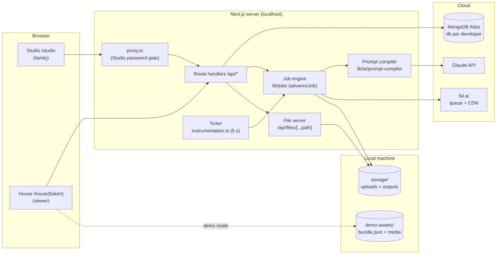
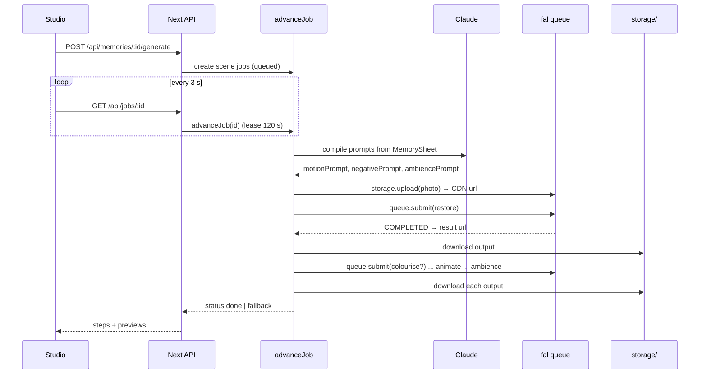

# TECHNICAL.md — memorAI

Single technical reference. If code and this file disagree, fix one of them in the same PR. Decisions here were validated by the team on 14 Nov 2026; product rules are in `AGENTS.md`.

Contents: 1 Architecture · 2 Repo layout · 3 Front-end · 4 Back-end & API contract · 5 Generation engine (jobs) · 6 Data & storage · 7 AI integrations · 8 Environments & secrets · 9 Fallback plan · 10 Troubleshooting · 11 Open items

---

## 1. Architecture

One Next.js 16 monolith (App Router, Node runtime) runs everything locally (`localhost:3000`). Two front-ends share it: **Studio** (family, `/studio`) and **House** (viewer, `/house/[token]`). AI calls run only on the server. Slow generations are **jobs** stored in MongoDB and advanced by polling plus an in-process ticker.



### 1.1 Data flow (one Memory)

1. Family uploads photos/song/voice → `POST /api/memories/:id/assets` → files saved to `storage/`, `assets` documents created. Photos are resized client-side to 2048 px JPEG before upload.
2. Family answers guided questions + optional free text → `PATCH /api/memories/:id` → server builds the **MemorySheet**.
3. `POST /api/memories/:id/generate` → one `scene` job per photo (status `queued`).
4. Jobs advance (ticker every 5 s + every `GET /api/jobs/:id`): compile prompts (Claude) → upload input to fal CDN → restore → colourise (if chosen) → animate → ambience → download every output to `storage/`.
5. Studio polls job status every 3 s and shows step names. When all scenes are `done` or `fallback`, the Memory becomes `ready_for_review`.
6. Family approves each scene (`POST /api/scenes/:id/choice`), orders Memories, publishes the Story.
7. House requests `GET /api/h/:token/bundle`, preloads every file, then shows "Choose a room".

### 1.2 Sequence of API calls (generation of one scene)



---

## 2. Repo layout

```
app/
  layout.tsx, globals.css (Tailwind v4 @theme tokens), fonts.ts
  page.tsx                         → redirects to /studio
  studio/                          → Studio (Alexandre)
    login/page.tsx
    page.tsx                       → Hear back (home) or Create the House if none
    house/new/page.tsx             → Family · Create the House
    stories/new/page.tsx           → Create · 1 Object
    memories/[id]/bank/page.tsx    → Create · 2 Memories (bank + guided questions + free text)
    memories/[id]/sheet/page.tsx   → Create · 2b Memory sheet
    memories/[id]/voice/page.tsx   → voice recording (no Figma frame yet)
    memories/[id]/life/page.tsx    → Create · 3 Bring to life (per-photo options + generation progress)
    memories/[id]/approve/page.tsx → Create · 3b Approve every scene
    stories/[id]/place/page.tsx    → Create · 4 Place (slot, order, OK alone, publish)
    care/page.tsx                  → Family · Care & privacy
  house/[token]/page.tsx           → House (Yasir)
  api/                             → route handlers (see §4)
components/
  ui/        shadcn + memorAI primitives (Raphaël)
  studio/    Studio components (Alexandre)
  house/     Room scene, objects, player, controls (Yasir)
lib/
  contracts/ Zod schemas: entities, MemorySheet, API I/O, bundle, errors (Timoté)
  db/        Mongo client + typed collection helpers (Timoté)
  ai/        models.ts, fal.ts (live|mock), claude.ts, prompt-compiler.ts, costs.ts (Timoté)
  jobs/      engine.ts (advanceJob), steps/*.ts, cache.ts, ticker.ts (Timoté)
  storage/   save/read/stream files, sha256, resize helpers (Timoté)
  house/     bundle builder + preload + player state (Yasir)
  http.ts    ok/fail/parseJson helpers for route handlers (Timoté)
  copy.ts    all user-facing strings (shared)
  session.ts Studio cookie sign/verify (shared, Timoté)
mocks/
  fal/<model-id>.json + mocks/media/* (CC0 sample outputs)
  claude/prompt-compiler.json
scripts/
  seed-demo.ts, export-demo.ts, demo-check.ts, reset-db.ts
public/
  brand/ (memorAI logo SVG), rooms/ (3 default room SVGs from Figma), objects/ (9 object SVGs from Figma), samples/ (CC0 photos for README)
proxy.ts            Studio gate (Next 16 renamed middleware.ts → proxy.ts)
instrumentation.ts  starts the job ticker once per process
storage/            gitignored — uploads + generated outputs
demo-assets/        gitignored — real demo content + bundle.json
```

Path alias `@/*` → repo root.

---

## 3. Front-end

### 3.1 Libraries

| Need | Choice | Notes |
|---|---|---|
| Framework | Next.js 16, React 19.2, TypeScript strict | Scaffold with `pnpm create next-app@latest` (App Router, Tailwind, no `src/`, alias `@/*`). It also scaffolds an `AGENTS.md`: keep ours. |
| Styling | Tailwind CSS v4 (CSS-first `@theme` in `globals.css`) + shadcn/ui | No `tailwind.config.js` needed. |
| Fonts | `next/font/google`: Fraunces (display), Nunito (body), Caveat (hand) | All SIL OFL. Remove DM Sans leftovers from Figma. |
| Server state | TanStack Query v5 | `refetchInterval: 3000` while a job is not final. |
| Client state | Zustand | House player store only. |
| Forms | React Hook Form + `@hookform/resolvers/zod` | Same schemas as the API. |
| 3D | `@react-three/fiber` + `@react-three/drei` | `useGLTF`, `ContactShadows`, `Environment`, `Float`. Client-only. |
| Audio | Howler.js | Three channels: song, ambience, voice (ducking). |
| Icons | `lucide-react` | Mapping from Figma custom icons in `docs/DESIGN.md`. |

### 3.2 Design tokens (from Figma v5 — raw values, no Figma variables exist)

`app/globals.css` (Raphaël owns it):

```css
@import "tailwindcss";

@theme {
  --color-background: #FBF3E8;
  --color-surface: #FFFCF6;
  --color-surface-muted: #F6EADB;
  --color-ink: #3B2A20;            /* merge leftover #2B2420 into this */
  --color-primary: #D9734E;
  --color-success: #7FA36F;
  --color-success-surface: #E3ECD9;
  --color-success-text: #4F7A44;
  --color-warning-surface: #FBE6D8;
  --color-danger: #C2412D;
  --color-switch-off: #DCD5CB;
  --color-overlay: #1E140D;
  --color-avatar-honey: #F2B45A;
  --color-avatar-sage: #8FB08A;
  --color-avatar-rose: #E79A86;
  --color-heart-from: #EE9475;
  --color-heart-to: #D2603D;
  --color-room-garden: #EFEDDA;
  --color-room-kitchen: #FBEAD2;
  --color-room-living: #F9E3D7;

  --font-display: var(--font-fraunces), serif;
  --font-body: var(--font-nunito), system-ui, sans-serif;
  --font-hand: var(--font-caveat), cursive;

  --radius-xs: 3px;  --radius-sm: 6px;  --radius-md: 10px; --radius-lg: 14px;
  --radius-xl: 16px; --radius-2xl: 20px; --radius-card: 24px; --radius-screen: 28px;
  --radius-3xl: 32px;

  --shadow-card: 0 12px 32px -4px rgba(122,74,42,0.07);
  --shadow-polaroid: 0 18px 34px -6px rgba(122,74,42,0.18);
  --shadow-object: 0 18px 30px 0 rgba(90,70,50,0.18);
  --shadow-round-button: 0 8px 24px 0 rgba(58,44,30,0.12);
  --shadow-heart: 0 18px 50px 0 rgba(217,115,78,0.45);

  --ease-memorai: cubic-bezier(0.22, 1, 0.36, 1);
}
```

shadcn variables (`--background`, `--foreground`, `--primary`, `--card`, `--muted`, `--destructive`, `--ring`, `--radius`) must point to these tokens (e.g. `--primary: var(--color-primary)`, `--radius: 24px`). Type scale (px): 12, 13, 14, 15, 16, 17, 18, 20, 22, 28, 32, 40, 44. Page side margin 72 px.

**Contrast fix (Figma gap):** secondary text below 0.7 opacity on cream fails WCAG AA; use `ink` at ≥ 0.7 opacity for any text that must be read.

### 3.3 Figma → code workflow

- Source of truth: Figma page **v5 · Full flow · memorAI**, all frames 1194 × 834 (iPad Pro 11" landscape). Never build from v1–v4.
- Each dev uses the Figma MCP server (`.mcp.json`) with the frame node link listed in `docs/DESIGN.md`; Claude Code skill `figma-to-component` / playbook `docs/playbooks/figma-to-component.md`.
- Export from Figma as SVG (Raphaël): memorAI logo → `public/brand/`, 3 room backgrounds → `public/rooms/{garden,kitchen,living}.svg`, 9 objects → `public/objects/*.svg`. Do not rebuild them in code.
- Figma's AI-generated placeholder photos must never ship as real content.
- Every screen built: capture Figma vs code side by side and log it in `docs/DESIGN.md` (evidence for the Figma prize).

### 3.4 House (viewer) behaviour

| Step | Behaviour | Figma frame |
|---|---|---|
| Preload | Fetch bundle, preload every image/clip/audio/GLB, show only the warm background colour. No spinner text. | — |
| Choose a room | Greeting with the person's first name, family avatars, one arch card per Room (320 × 480). If the House has one Room, still shown (big single card). | Choose a room (20-67) |
| Room | Room background (SVG or family photo), Objects on fixed Slots with floor shadow, empty Slots shown as soft spots, "Watching together / On your own" pill, Rooms button (64 px) back to Choose a room. Gentle float on Objects. | Room · Garden (20-176) |
| Touch Object | First tap also unlocks audio. Object scales up, others fade, Memory polaroids fly out (0.9 s, `--ease-memorai`). Tapping a polaroid starts that Memory; with no tap, the first Memory starts after 3 s. | Garden — Flower opened (20-219) |
| Memory | Full screen: clips cross-fade (0.6 s) in family order; song + ambience; family voice once with music ducked to 30 %; optional caption (Fraunces Italic 32); segmented progress; Back (92), Pause (124), Return to the room (76). | Story · Memory playing (20-624) |
| Heart | Heart button 230 px + "Next memory" pill; continues automatically after 10 s. | Story · Send love (20-668) |
| End | After the last Memory: soft fade back to the Room. | (no frame yet) |
| Alone mode | `?mode=alone` (set by the family link): only "OK alone" Memories; Objects without any stay in place at 0.28 opacity and do nothing. | Garden — watching alone (20-701) |

Responsive: design at 1194 × 834; scale the scene to fit with letterboxing in the background colour; portrait/phone uses the same scene inside a safe zone. Respect `prefers-reduced-motion` (no float, no fly-out, fades only).

**3D Objects:** an Object is either a **GLB** (generated from the family's photo) or a **library SVG** (Figma illustrations) rendered as a textured plane. Both get the same floor shadow and float. Because the Figma world is illustrated, GLBs use soft, warm lighting (`Environment preset="apartment"`, low intensity, no harsh specular). Test 1 (`TESTING.md`) decides whether GLBs fit; if not, library SVGs are the demo default and the GLB is shown only on the Object step of the Studio.

### 3.5 Studio behaviour

- Desktop-first, centred 1194 px canvas (Figma size) with `max-width`; on phone, single column. Stepper across Create steps.
- Autosave each step (PATCH on blur/next). Back never loses input.
- Generation progress shows plain step names from `lib/copy.ts`: "Restoring the photo", "Bringing back the colour", "Bringing the scene to life", "Adding the sound of the place". The original photo with a slow zoom is shown while waiting. The family can leave and come back.
- Every scene in `fallback` shows two buttons: **Try again** (bypasses cache, counts toward rate limit) and **Keep the original photo**.

---

## 4. Back-end & API contract

All routes are Next route handlers under `app/api/`, Node runtime. Every input and output is a Zod schema in `lib/contracts/api.ts`. Success: `{ data: T }`. Error: `{ error: { code: string, message: string, retryable: boolean } }` with HTTP 400/401/404/409/413/422/429/500.

### 4.1 Auth

- **Studio:** `POST /api/auth/login { password }` compares with `STUDIO_PASSWORD`, sets `mh_session` (HMAC-signed with `SESSION_SECRET`, httpOnly, sameSite=lax, 7 days). `proxy.ts` guards `/studio/**` (except `/studio/login`) and `/api/**` except `/api/auth/login`, `/api/auth/logout`, `/api/h/**` and `/api/files/**` (files check either a session or a valid House token query param).
- **House:** token = 32 random bytes, base64url, stored on the House. Read-only routes under `/api/h/:token/*`. Revocable (`houses.tokenRevoked`).
- **Rate limit:** max 10 generation starts (generate + try again) per House per hour → 429 `rate_limited`.
- All pages send `X-Robots-Tag: noindex`.

### 4.2 Core schemas (abridged; full definitions in `lib/contracts/`)

```ts
// lib/contracts/memory-sheet.ts
export const MemorySheet = z.object({
  title: z.string().max(80),                 // "Christmas by the fire, 1982"
  people: z.array(z.string().max(60)).max(10),
  place: z.string().max(120).optional(),
  when: z.string().max(40).optional(),
  soundOfPlace: z.string().max(160).optional(), // "fire crackling, children laughing"
  songAssetId: z.string().optional(),
  message: z.string().max(400).optional(),   // what the family wants to say (text)
  voiceAssetId: z.string().optional(),
  colour: z.enum(["keep_bw", "colourise", "already_colour"]),
  restore: z.boolean().default(true),
  motion: z.enum(["gentle", "still"]).default("gentle"),
  freeText: z.string().max(500).optional(),  // passed only through the prompt compiler
  okAlone: z.boolean().default(false),
  source: z.enum(["form", "text_agent", "voice_agent"]).default("form"),
});

// Guided questions (Studio form, future agents ask the same):
// who is in the photo · where & when · what did it sound like · which song ·
// a message or narration? · keep black & white or bring colour back · OK to watch alone?
```

```ts
// lib/contracts/house-bundle.ts — what the House downloads
export const HouseBundle = z.object({
  house: z.object({ firstName: z.string(), avatars: z.array(z.object({ initial: z.string(), color: z.string() })) }),
  mode: z.enum(["together", "alone"]),
  rooms: z.array(z.object({
    id: z.string(), name: z.string(), background: z.string(), // URL
    slots: z.array(z.object({
      id: z.string(), x: z.number(), y: z.number(), scale: z.number(), // normalised 0..1 on 1194×834
      story: z.object({
        id: z.string(), title: z.string(),
        object: z.object({ kind: z.enum(["glb", "svg"]), url: z.string() }),
        available: z.boolean(), // false in alone mode if no OK-alone Memory
        memories: z.array(z.object({
          id: z.string(), title: z.string(), polaroidUrl: z.string(), caption: z.string().optional(),
          scenes: z.array(z.object({ kind: z.enum(["clip", "photo", "video"]), url: z.string(), durationMs: z.number() })),
          songUrl: z.string().optional(), ambienceUrl: z.string().optional(),
          voiceUrl: z.string().optional(), voiceDurationMs: z.number().optional(),
        })),
      }).nullable(), // null = empty slot
    })),
  })),
  files: z.array(z.string()), // every URL to preload
});
```

### 4.3 Routes

**Studio (session required)**

| Method & path | Body → Response | Owner |
|---|---|---|
| POST `/api/auth/login` | `{ password }` → `{ ok: true }` | Timoté |
| POST `/api/houses` | `{ firstName, consent: true }` → `House` | Alexandre |
| POST `/api/houses/:id/assets` | multipart `file` (Object photo, JPEG ≤ 15 MB after client resize) → `AssetView`; House-scoped, no Memory needed | Alexandre (S2) |
| GET `/api/rooms/:id` | → `Room` (Studio session required) | Alexandre (S2) |
| GET `/api/stories/:id` | → `Story` (including unpublished drafts, Studio only) | Alexandre (S2) |
| GET `/api/stories/:id/object-job` | → `JobView`; temporary S2 mock progress adapter until P5, refuses non-mock generation | Alexandre (S2) |
| GET `/api/houses/:id` | → `House` with rooms, stories summary | Alexandre |
| PATCH `/api/houses/:id` | `{ firstName?, dontShow?: string[] }` → `House` | Alexandre |
| DELETE `/api/houses/:id` | → `{ deleted: true }` (cascade, files included) | Timoté |
| POST `/api/houses/:id/rooms` | `{ name, source: "style", style: "garden"\|"kitchen"\|"living" }` or `{ name, source: "photo", assetId }` → `Room` (+ job `room_background` if photo) | Alexandre |
| POST `/api/rooms/:id/stories` | `{ slotId, title, object: { kind: "photo", assetId } \| { kind: "library", name } }` → `Story` (+ job `object_3d` if photo) | Alexandre |
| PATCH `/api/stories/:id` | `{ title?, memoryOrder?: string[], slotId? }` → `Story` | Alexandre |
| POST `/api/stories/:id/memories` | `{ title }` → `Memory` | Alexandre |
| GET `/api/memories/:id` | → `Memory` + assets + scenes + status | Alexandre |
| PATCH `/api/memories/:id` | `{ answers?, freeText?, okAlone?, title? }` → `Memory` with rebuilt `sheet` | Alexandre |
| POST `/api/memories/:id/assets` | multipart `file`, `kind`: photo\|video\|song\|voice\|audio → `Asset` (limits: photo 15 MB, audio 20 MB, video 100 MB; JPEG/PNG/HEIC, MP4/MOV, MP3/M4A/WAV/WEBM) | Timoté (storage) / Alexandre (UI) |
| DELETE `/api/assets/:id` | → `{ deleted: true }` | Alexandre |
| POST `/api/memories/:id/generate` | `{}` → `{ jobIds: string[] }` | Timoté |
| GET `/api/jobs/:id` | → `Job` (advances it) | Timoté |
| POST `/api/scenes/:id/choice` | `{ use: "animated"\|"still", colour: "bw"\|"colour", restored: boolean }` → `Scene` | Alexandre |
| POST `/api/scenes/:id/retry` | `{}` → `{ jobId }` (bypass cache) | Timoté |
| POST `/api/stories/:id/publish` | `{}` → `Story` (409 if a Memory is not fully approved) | Alexandre |
| GET `/api/houses/:id/feedback` | → `{ views, hearts, perMemory: [...] }` | Alexandre |
| GET `/api/houses/:id/link` | → `{ url, aloneUrl }` | Alexandre |

**House (token)**

| Method & path | Response | Owner |
|---|---|---|
| GET `/api/h/:token/bundle?mode=together\|alone` | `HouseBundle` (published Stories only; "don't show" applied at publish time; alone mode filters by `okAlone`) | Yasir |
| POST `/api/h/:token/events` | `{ type: "heart"\|"view_started"\|"view_completed", memoryId }` → `{ ok: true }` | Yasir |

**Files:** GET `/api/files/[...path]` streams from `STORAGE_DIR` with **HTTP Range** support (206 responses) and correct `Content-Type`; rejects `..` paths.

**Reserved (not MUST):** POST `/api/agent/messages` (SSE, text agent filling a MemorySheet with tool calls) · ElevenLabs agent tools calling the same Studio routes.

### 4.4 Errors and retries

- Each job step: up to 2 retries with backoff (5 s, 15 s) for bad/failed results. fal already retries 5xx/429 in its queue.
- After that: scene status `fallback` (original photo + slow zoom; ambience from text if possible). Studio shows Try again / Keep the original photo.
- Error codes: `validation_failed`, `unauthorized`, `not_found`, `conflict`, `file_too_large`, `unsupported_type`, `rate_limited`, `budget_exceeded`, `upstream_failed`, `internal`.

---

## 5. Generation engine (jobs)

### 5.1 Job document

```ts
type JobType = "scene" | "room_background" | "object_3d";
type StepName = "compile" | "upload" | "restore" | "colourise" | "animate" | "ambience" | "cutout" | "model3d" | "compress" | "room_edit" | "finalize";
interface Job {
  _id: ObjectId; type: JobType; houseId; memoryId?; sceneId?; storyId?; roomId?;
  steps: { name: StepName; status: "pending"|"running"|"done"|"skipped"|"failed";
           model?: string; falRequestId?: string; output?: string /* storage path */;
           costUsd?: number; attempts: number; error?: string }[];
  current: number;                       // index in steps
  status: "queued" | "running" | "done" | "fallback" | "failed";
  lockedUntil?: Date; falKeyLabel: string; createdAt; updatedAt;
}
```

Step plans: **scene** = compile → upload → restore (if `restore`) → colourise (if `colourise`) → animate (if `motion=gentle`) → ambience → finalize. **object_3d** = upload → cutout → model3d → compress → finalize. **room_background** = upload → room_edit → finalize.

### 5.2 `advanceJob(id)` rules

1. Acquire a lease: `findOneAndUpdate({ _id, $or: [{ lockedUntil: null }, { lockedUntil: { $lt: now } }] }, { $set: { lockedUntil: now + 120 s } })`. (120 s, not 10: the lease must outlast a clip upload/download, or job polling takes the job mid-download and the step never saves.) No lease → return current state.
2. Current step has `falRequestId` → `fal.queue.status`. `COMPLETED` → `fal.queue.result` → download output to `storage/<houseId>/<jobId>/<step>.<ext>` → mark done → next step. Still running → release lease, return.
3. Step not submitted → check **cache** (`generation_cache` by key) → hit: reuse output. Miss: check concurrency (`count(steps running with falRequestId) < FAL_MAX_CONCURRENCY`, default 2) and budget (`sum(costUsd for falKeyLabel) < FAL_BUDGET_USD`, else switch to mock and set `budget_exceeded` notice) → `fal.queue.submit` → store `falRequestId`.
4. Failure → `attempts++`; after 2 retries → job `fallback` (scene) or `failed` (object → library fallback, room → default style).
5. Always release the lease at the end.

**Ticker:** `instrumentation.ts` calls `startTicker()` (guarded by `globalThis.__mhTicker` so dev hot reload never starts it twice): every 5 s, `advanceJob` for up to 4 non-final jobs. Does nothing when no job is active. Works with `next start` on our laptops; on serverless hosting it would not run (polling still works).

**Cache key:** `sha256(model + JSON.stringify(sortedParams) + inputFileSha256)`. Prompt text is inside params. "Try again" sets `bypassCache`.

**Memory status** (computed): `draft` → `generating` (any job not final) → `ready_for_review` (all scenes `done`/`fallback`) → `approved` (all scenes have a choice) → `published`.

---

## 6. Data & storage

- **MongoDB Atlas**, one free M0 cluster, one database per developer (`MONGODB_DB=mh_timote|mh_alexandre|mh_yasir|mh_raphael`) + `mh_demo`. Network access: allow all IPs for the hackathon (strong DB password; rotate after). Official `mongodb` driver; every document parsed with its Zod schema in `lib/db/collections.ts`.
- **Collections:** `houses` (firstName, token, tokenRevoked, dontShow[], consentAt), `rooms` (houseId, name, source, style?, backgroundPath, slots[] embedded {id,x,y,scale,storyId?}), `stories` (roomId, slotId, title, object {kind, path, jobId?}, memoryOrder[], publishedAt?), `memories` (storyId, title, answers, freeText, sheet, okAlone, status), `assets` (houseId, memoryId?, kind, path, mime, bytes, sha256, falUrl?, falUrlExpiresAt?), `scenes` (memoryId, assetId, order, outputs {restored?, colourised?, clip?, ambience?}, choice?, status), `jobs`, `events` (houseId, memoryId, type, at), `generation_cache` (key, model, outputPath, costUsd, createdAt).
- Indexes: `houses.token` unique; `jobs.status`; `events.houseId`; `generation_cache.key` unique; `stories.roomId`.
- **Storage:** local disk `STORAGE_DIR` (default `./storage`, gitignored), path `storage/<houseId>/...`. Never under `public/` (files added after `next build` are not served).
- **Demo:** `demo-assets/` (gitignored, shared by USB/drive) holds real demo photos, voice, song and the generated outputs + `bundle.json`. `pnpm seed:demo` loads it into `mh_demo`; `pnpm export:demo` rewrites `bundle.json` from `mh_demo` (run after every demo content change). `HOUSE_DEMO_MODE=true` makes `/house/demo-token` read `demo-assets/bundle.json` with no DB call.
- **Public repo:** only CC0 sample images in `public/samples/`. Never real family photos, voices or copyrighted songs.
- **Deletion (GDPR):** `DELETE /api/houses/:id` removes all documents and `storage/<houseId>/`.

---

## 7. AI integrations

All model IDs and default params live in `lib/ai/models.ts`. Verify each ID and input schema in the fal playground before first live use (`https://fal.ai/models/<id>/api`); prices marked "measure" must be read from the fal dashboard after the first call and written here.

### 7.1 fal models

| Step | Model ID | Key params | Price (as checked 14 Nov 2026) | Fallback |
|---|---|---|---|---|
| restore | `topaz/restore/image` (Recover 3 / Dust-Scratch V2) | model choice per photo condition | per output megapixel — **measure** | skip step (use original) |
| colourise | `bria/fibo-edit/colorize` | `image_url`, `color: "contemporary color"` | $0.04 / image | `fal-ai/ddcolor` (measure) |
| animate | Kling 2.5 Turbo Pro image-to-video (verify exact ID in playground, e.g. `fal-ai/kling-video/v2.5-turbo/pro/image-to-video`) | 5 s, no audio, `prompt` = motionPrompt, `negative_prompt` | ≈ $0.07 / s (≈ $0.35 / scene) | **watch list:** Veo 3.1 (≈ $0.20 / s), Seedance 2.0 fast; final: still photo |
| ambience (clip) | `fal-ai/mmaudio-v2` | `video_url`, `prompt` = ambiencePrompt + "no music" | $0.001 / s | text-only below |
| ambience (still) | `fal-ai/mmaudio-v2/text-to-audio` | `prompt`, duration = scene length | $0.001 / s | silence (song only) |
| cutout | a background-removal model (e.g. BiRefNet on fal — verify ID) | `image_url` | measure | send photo as is |
| model3d | `fal-ai/hyper3d/rodin/v2.5/fast` | cutout as `image_urls: [url]`, tier `Gen-2.5-Extreme-Low`, GLB | $0.10 / generation (20K faces max; measured in Test 4) | `fal-ai/trellis-2` (texture 1024, decimation 20000; $0.30 / run, weaker on busy photos, Test 4) → library SVG |
| compress | local `@gltf-transform/functions` in process (dedup, prune, weld, textures ≤ 1024 px WebP) | target < 3 MB per GLB | free | keep raw GLB |
| room_edit | `fal-ai/nano-banana-2/edit` | family room photo + "warm, tidy, soft light, keep the room" | $0.08 / image | default illustrated style |

Default room styles are **not generated**: they are the 3 Figma SVG scenes (garden, kitchen, living) in `public/rooms/`.

**Estimated cost:** ≈ $0.45–0.50 per scene, ≈ $1.50 per Memory of 3 photos, $0.10 per Object. One $25 demo key ≈ 5–6 complete Stories.

**Limits:** new fal accounts run **2 requests concurrently**; extra queue requests wait (never dropped). Each developer uses **their own key**; the demo key is used only for final demo content.

**fal client usage:** `fal.config({ credentials: process.env.FAL_KEY })` server-side only. Inputs: `fal.storage.upload(file)` → public CDN URL (needed because our files are on localhost). Send header `X-Fal-Object-Lifecycle-Preference: {"expiration_duration_seconds": 3600}` on uploads and requests (we keep our own copies). Use `fal.queue.submit` / `status` / `result`, never `subscribe` inside a request handler.

### 7.2 Prompt compiler (Claude)

- `lib/ai/prompt-compiler.ts`, `@anthropic-ai/sdk`, model `CLAUDE_PROMPT_MODEL` (default `claude-haiku-5-5`; `claude-sonnet-5-5` if quality is poor).
- Input: MemorySheet + photo description. Output (forced JSON via tool schema): `{ motionPrompt, negativePrompt, ambiencePrompt, colourStyle, refusedRequests: string[] }`.
- System rules: describe only subtle natural motion of what is already in the photo (breathing, hair, fire flicker, leaves, light); never add or remove people, objects, places or events; no camera cuts; ambience = sounds of the place, never music; if free text asks to add something absent, put it in `refusedRequests` and ignore it. The Studio shows refused requests gently ("We only bring to life what is in the photo").
- Fallback (Claude down or mock): fixed templates in `lib/ai/prompt-templates.ts`.
- Default negative prompt: "new people, extra people, new objects, face change, morphing, distorted face, fast motion, camera cut, text, watermark".

### 7.3 ElevenLabs (option)

Not in MUST. Go/no-go at 02:00 Sunday (see `PLAN.md`). If go: an ElevenLabs conversational agent asks the same guided questions and fills the MemorySheet through a tool call to `PATCH /api/memories/:id`. Check current ElevenLabs agent docs before starting. `ELEVENLABS_API_KEY` server-side only.

### 7.4 Mock mode

`AI_MODE=mock` (default in dev, CI, tests): `lib/ai/fal.ts` returns fixtures from `mocks/fal/<model>.json` pointing at CC0 files in `mocks/media/` after a 2–5 s fake delay; 1 call in 10 fails (set `MOCK_FAIL_RATE=0` to disable). `lib/ai/claude.ts` returns `mocks/claude/prompt-compiler.json`. The mock implements exactly the same interface as live.

Implementation notes (F3):
- Interface `FalGateway` from `getFal()`: `upload(blob) → url`, `submit(modelKey, input) → requestId`, `status(modelKey, requestId) → IN_QUEUE|IN_PROGRESS|COMPLETED`, `result(modelKey, requestId) → { requestId, data }`. `extractOutput(modelKey, data)` returns `{ url, mime }` using the output path declared in `models.ts`. Live merges the model defaults from `models.ts` under the caller's input; the mock ignores inputs.
- Errors from both modes are `AiRequestError { code, retryable }`. Like fal, a failed mock request reports `COMPLETED` and then `result()` throws; `result()` before completion throws `not_ready`.
- Mock request IDs carry their own state (`mock_<submittedAt>_<delay>_<fail>_<nonce>`), so mock jobs survive a dev-server restart like live ones.
- Mock outputs are `file://…/mocks/media/<file>` URLs: the engine's download step must copy them from disk (`isMockUrl(url)`). Mock uploads return a fake `https://mock.fal.media/...` URL.
- `AI_MODE` is live only when exactly `live`. Fixture files are named after the model ID with `/` → `__`; mock paths resolve from the process working directory, so run the app from the repo root. A mock request ID replayed in live mode (or the reverse) fails as non-retryable `unknown_request`.
- Live Claude uses structured outputs (`output_config.format` with the `CompiledPrompts` Zod schema) rather than a forced tool call, because forced `tool_choice` is rejected by `claude-sonnet-5-5`. `compilePrompts()` never throws: any failure or invalid output falls back to `lib/ai/prompt-templates.ts`, and the default negative prompt (extra terms capped at 500 chars), "no music" and `colourStyle: "none"` unless the family chose to colourise are always enforced.

---

## 8. Environments & secrets

`.env.example` is committed; each person copies it to `.env.local` (gitignored). Variables:

| Variable | Example | Purpose |
|---|---|---|
| `AI_MODE` | `mock` | `mock` \| `live` |
| `MOCK_FAIL_RATE` | `0.1` | mock failure rate |
| `STUDIO_MOCK_STORE` | `false` | Explicit offline S1 test store; only allowed with `AI_MODE=mock`. Unset/false uses F4 MongoDB even in AI mock mode. Playwright enables it for its test server. |
| `FAL_KEY` | — | personal fal key (server only) |
| `FAL_KEY_LABEL` | `dev-timote` / `demo` | budget accounting per key |
| `FAL_BUDGET_USD` | `5` | switch to mock above this spend |
| `FAL_MAX_CONCURRENCY` | `2` | fal requests in flight |
| `ANTHROPIC_API_KEY` | — | prompt compiler |
| `CLAUDE_PROMPT_MODEL` | `claude-haiku-5-5` | |
| `MONGODB_URI` | — | Atlas URI |
| `MONGODB_DB` | `mh_timote` | your own DB |
| `STORAGE_DIR` | `./storage` | |
| `DEMO_ASSETS_DIR` | `./demo-assets` | |
| `HOUSE_DEMO_MODE` | `false` | serve demo bundle without DB |
| `DEMO_HOUSE_TOKEN` | `demo-token` | |
| `STUDIO_PASSWORD` | — | demo password |
| `SESSION_SECRET` | 32+ random chars | cookie HMAC |
| `GENERATION_RATE_LIMIT` | `10` | per House per hour |
| `OWNER_ZONE` | `pipeline` | used by Claude Code hooks |
| `ELEVENLABS_API_KEY` | — | optional |

Rules: nothing secret in `NEXT_PUBLIC_*`; pre-commit secret scan (husky); Claude Code hook blocks `.env*`; CI runs with dummy values and `AI_MODE=mock`.

**Local dev:** Node ≥ 24 (`.nvmrc` = 24), pnpm, `pnpm install`, `cp .env.example .env.local`, fill your values, `pnpm env:check` (names only, never values), `pnpm dev`. **Demo:** `pnpm demo` (build + seed + `next start`), open `/studio` and `/house/demo-token` (Chrome devtools tablet size 1194 × 834) on the same laptop.

---

## 9. Fallback plan

| Dependency | Failure | Fallback |
|---|---|---|
| fal slow/down | Live generation stalls | Cache hit on the demo photo; approval screen and Story pre-generated; say on stage it was prepared ("real generation takes about 2 minutes") |
| fal credits | Budget reached / key empty | `FAL_BUDGET_USD` switches to mock; second funded key ready in `.env.local` (`FAL_KEY_LABEL` changed) |
| Kling quality | Faces change / artefacts | Swap model in `lib/ai/models.ts` (Veo 3.1); family keeps still photo |
| Claude API | Prompt compiler fails | Fixed templates |
| Wi-Fi / Atlas | Studio cannot load | House demo mode works offline; phone hotspot for Studio |
| Demo laptop | Crash / battery | Any of the 4 laptops has the same build + `demo-assets/` (checked Sunday 10:00) |
| 3D object | Ugly or heavy GLB | Library SVG object; memory-box layout as last resort |
| Audio | Silent on first play | First tap unlocks audio; check system volume/output before stage |
| Projector | Odd resolution | Scene letterboxes to safe zone; test on external screen |

---

## 10. Troubleshooting

| Symptom | Cause | Fix |
|---|---|---|
| Live scene stuck on one step although fal finished | Lease (10 s) expired during the clip upload/download; job polling took the job, so the finished step could not save, forever | Lease is 120 s (`lib/jobs/config.ts`), released as soon as an advance ends |
| Jobs advance twice / duplicate fal calls in dev | Ticker started again by hot reload | `globalThis.__mhTicker` guard + DB lease; demo always in `next start` |
| `window is not defined` / build fails on Room | R3F rendered on the server | `dynamic(() => import(...), { ssr: false })`, `"use client"` |
| Story starts silent (Safari/iPad) | Autoplay policy | Start Howler only inside the tap handler; call `Howler.ctx.resume()` |
| Video won't play or seek on Safari | No Range support | `/api/files` must return 206 with `Content-Range`, `Accept-Ranges: bytes` |
| `MongoServerSelectionError` | IP not allowed / no network | Atlas Network Access: allow 0.0.0.0/0; check Wi-Fi; use demo mode |
| Not sure the DB works | — | `pnpm db:ping` (connect + insert + read + delete, prints the DB name only), then `pnpm db:indexes` once per DB |
| Node script crashes with "This module cannot be imported from a Client Component" or cannot resolve `@/` | `lib/db/*` starts with `import "server-only"` and uses the `@/` alias, which plain Node does not resolve | Scripts use the raw `mongodb` driver like `scripts/db-ping.mts`, importing only dependency-free files with a `.ts` extension (e.g. `lib/db/indexes.ts`) |
| New file in `public/` 404 in production | Next serves `public/` as of build time | Serve generated files from `storage/` via `/api/files` |
| fal output URL 404 later | CDN expiry (we set 1 h) | Always download outputs to `storage/` when the step completes |
| Jobs stuck "IN_QUEUE" | Account concurrency = 2, other dev on same key | One key per developer; `FAL_MAX_CONCURRENCY=2` |
| `/studio` loops back to sign-in, or login returns 500 "not configured" | `STUDIO_PASSWORD` missing or `SESSION_SECRET` shorter than 32 chars | `pnpm env:check` (prints names only, never values); generate a secret with `node -e "console.log(crypto.randomBytes(32).toString('base64url'))"` |
| fal 401/403 | Wrong key or credits on another account | Check `FAL_KEY`, check dashboard balance |
| GLB loads slowly / tablet lags | Heavy mesh/textures | `gltf-transform optimize`, textures 1024 webp, ≤ 6 objects per Room |
| Hydration mismatch on House | Random/Date in render | Generate random values in effects or seed them from ids |
| `middleware.ts` ignored | Next 16 renamed it | Use `proxy.ts` |
| Upload 413 | File over limit | Client resize; limits in §4.3 |
| Claude returns non-JSON | No tool schema | Use forced tool output; fallback templates |
| CI fails on missing env | Env read at import time | Read env lazily in functions; dummy values in CI |

---

## 11. Open items

- Exact Kling 2.5 Turbo Pro endpoint ID and input schema (verify in playground).
- Topaz, DDColor, cutout model prices (Trellis 2: $0.30 / run, measured in Test 4) (measure after first call).
- Test 1 result: GLB vs library SVG as demo Objects.
- Test 2 result: Kling vs Veo 3.1 for demo scenes.
- Missing Figma frames (see `docs/DESIGN.md` → Gaps): free text, full question set, voice recording, ordering, publish confirmation, Story end, loading/error states, room photo upload, phone/desktop Studio.
